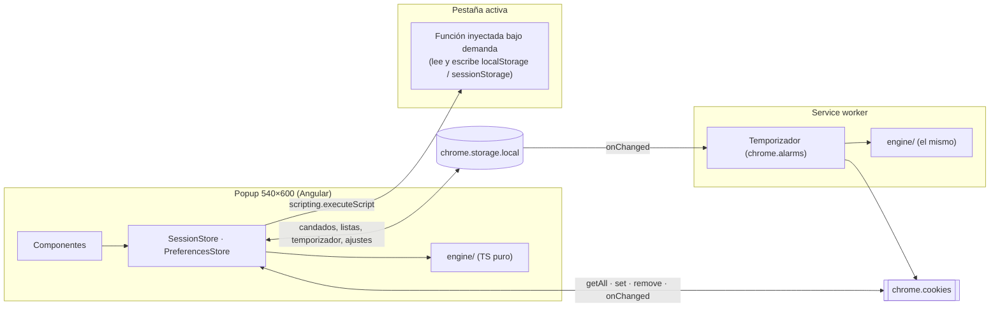

# Arquitectura de ReSession

Este documento fija **la estructura del proyecto y por qué es así**. El *cómo* de cada pieza está en la [guía](guide/README.md).

Si una decisión deja de servir, se cambia aquí primero, en el [registro de decisiones](#11-registro-de-decisiones), y después en el código.

- Aspecto, estados y textos: [visual.md](visual.md)
- Qué construir y en qué orden: [guide/README.md](guide/README.md)
- Sistema de diseño (tokens, clases `re-*`, reglas R1–R13): `ReDesign` (`AGENTS.md`, `docs/products/resession.md`)
- Maqueta de referencia: `src/app/mockup/`

---

## 1. Qué es ReSession

Inspector y limpiador de **cookies y storage** del navegador, con una garantía central:

> **Lo protegido nunca se limpia:** cookies con candado y sitios en lista blanca.

| Vista | Qué muestra | Qué permite |
|---|---|---|
| **Esta pestaña** | Cookies y storage del sitio activo, agrupados por subdominio, dominio raíz y rastreadores | Editar, eliminar, candado, limpiar por grupo o en lote, vaciar el storage |
| **Global** | Todas las cookies del navegador: sitio → dominio → cookie | Buscar, proteger la selección, limpiar por sitio, por dominio o todo |
| **Auto** | Temporizador y listas blanca y negra | Limpieza periódica, qué limpia cada ciclo, gestionar las listas |

Todo lo demás (editor, confirmación, toast, menú de ajustes, ayuda) es una capa **dentro del popup**.

---

## 2. Contextos de ejecución

Una extensión MV3 son varios programas que **no comparten memoria**:



- **Popup**: la app Angular. Se destruye al perder el foco, así que **no puede ser responsable de nada periódico**.
- **Service worker**: temporizador y atajos. Chrome lo detiene tras ~30 s sin eventos: **no guarda nada en memoria**, lee `chrome.storage.local` en cada evento.
- **Pestaña activa**: su storage solo se lee desde la propia página. Se inyecta una función **puntual**, sin content script permanente.

| Dato | Dónde vive | Quién lo escribe |
|---|---|---|
| Cookies | **En el navegador**. ReSession nunca las copia (D3) | El usuario, el temporizador… y los propios sitios |
| Candados, listas, temporizador, ajustes | `chrome.storage.local` | El popup; el service worker solo lee (y escribe el resultado del ciclo) |
| localStorage / sessionStorage | En la página | El usuario desde el popup y la propia página |

---

## 3. Estructura de carpetas

```
src/
├── engine/                  # TS puro: sin Angular ni chrome.*. Lo usan el popup y el service worker.
│   ├── models.ts            # Cookie, CookieGroup, SiteNode, StorageEntry, SiteRule, TimerConfig…
│   ├── format.ts            # Detectar JWT / JSON, decodificar un JWT, bytes de una entrada
│   ├── cookie.ts            # Validar (D17), identidad (D8), URL para borrar, datos para chrome.cookies.set
│   ├── domains.ts           # Normalizar host, dominio registrable, patrones de las listas (D9)
│   ├── protection.ts        # ¿Está protegida? + plan de limpieza (D6)
│   ├── tree.ts              # Grupos de «Esta pestaña», árbol de «Global», búsqueda
│   ├── trackers.ts          # Clasificar un dominio (+ trackers.json)
│   └── storage-keys.ts      # Claves de chrome.storage.local y migraciones
├── entrypoints/
│   └── background.ts        # Service worker: temporizador y atajos (usa engine/)
└── app/
    ├── app.ts · app.html    # Shell: vista activa y capas
    ├── state/               # session.store.ts · preferences.store.ts
    ├── shared/              # tree-head-toggle (directiva) · locale-format (Intl) · sets
    ├── feedback/            # toast y confirmación (servicio + componente)
    ├── cookies/             # cookie-item · cookie-container       ← lo usan «Esta pestaña» y «Global»
    ├── toolbar/             # search-bar · batch-bar               ← lo usan «Esta pestaña» y «Global»
    ├── tab/                 # tab-view · storage-item · storage-container
    ├── global/              # global-view · site-container
    ├── auto/                # auto-view · timer-card · site-rule-item · site-rule-container
    ├── shell/               # header · settings-menu · status-bar · help-panel
    └── editor/              # cookie-editor + su servicio
```

**Una sola regla para decidir dónde va algo:** si lo usa una vista, vive en la carpeta de esa vista; si lo usan dos, sube a su propia carpeta (`cookies/`, `toolbar/`, `feedback/`). Lo pequeño y compartido que no es un componente va en `shared/`. Sin barrels ni alias por capa.

Dentro de cada carpeta, los componentes van en `components/<nombre>/<nombre>.ts` y la vista en `<carpeta>-view/` (`tab/tab-view/tab-view.ts`). Los servicios y los modelos de la carpeta, en su raíz (`feedback/toast.service.ts`, `editor/models.ts`).

**Formatear según el idioma no es del engine** (D27): `engine/format.ts` cuenta bytes; escribirlos como «1,7 KB» o «hace 3 h» es `shared/locale-format.ts`, con `Intl` y el idioma activo.

**Por qué `engine/` aparte y plano:**

- La garantía tiene que cumplirse igual cuando limpia el usuario y cuando limpia el temporizador en el service worker. Una sola implementación, sin Angular ni `chrome.*`, que se prueba con datos.
- Archivos planos, uno por cosa que se prueba por separado. Una carpeta por cada función de 20 líneas solo añade imports.

---

## 4. Piezas de la interfaz

La UI se construye **de las hojas hacia arriba** (orden de la [guía](guide/README.md)). Hay cuatro tipos de pieza:

| Pieza | Ejemplos | Recibe | Hace |
|---|---|---|---|
| **Item** | `cookie-item`, `storage-item`, `site-rule-item` | Solo inputs | Pinta **una** cosa. Emite intenciones (`toggleLock`, `edit`, `remove`) sin saber qué pasará. No inyecta servicios que actúan; leer el idioma activo, sí |
| **Container** | `cookie-container`, `storage-container`, `site-container`, `site-rule-container` | Los datos de su grupo | Itera sus items y **resuelve sus operaciones**: decide si hace falta confirmar, ejecuta, avisa con el toast |
| **Vista** | `tab-view`, `global-view`, `auto-view` | Nada | Dueña del estado de la vista (búsqueda, selección, plegado) y de las acciones en lote. Es la única que lee los datos |
| **Shell** | `app` | Nada | Vista activa, header, status bar y capas |

Además:

- **Un item nunca decide.** Recibe `locked` y lo pinta; qué pasa al pulsar lo decide su container.
- **Las capas se piden a un servicio**, no se abren con un booleano en un hermano. `confirm.ask(...)` y `editor.open(...)` devuelven una `Promise` con la respuesta; quien preguntó sigue con su operación. Así cualquier container puede pedir una confirmación sin conocer al diálogo.
- **El host del componente es la raíz del bloque.** ReDesign usa selectores como `.re-tree__group + .re-tree__group`: si el `<section>` quedara dentro de `<app-cookie-container>`, los grupos dejarían de ser hermanos y se perderían los bordes. Las clases raíz van en `host` y la plantilla empieza por los hijos.

---

## 5. Estado

Dos stores, uno por **dueño del dato**:

| Store | Qué contiene | De dónde sale |
|---|---|---|
| `SessionStore` | Pestaña activa (URL, host, `storeId`), cookies en vivo, storage de la página | `chrome.tabs`, `chrome.cookies` (+ `onChanged`), `chrome.scripting` |
| `PreferencesStore` | Candados, listas blanca y negra, temporizador, idioma y tema | `chrome.storage.local` |

El estado de la UI (vista activa, cookies/storage, grupos plegados, búsqueda, selección) **no es un store**: son signals del shell o de cada vista. Lo que deba recordarse al reabrir va a `localStorage` (D21).

- **Lo derivado no se guarda.** Grupos, conteos, «está protegida» y resultados de búsqueda son `computed` sobre funciones del engine.
- **Mutaciones propias optimistas** (candado, lista, temporizador): cambian el signal, persisten y revierten si falla.
- **Mutaciones de cookies no optimistas**: se ejecutan en el navegador y la vista se actualiza con `onChanged`. Una cookie que la UI da por borrada sin que Chrome la haya borrado mentiría sobre la garantía.
- Los stores llaman a `chrome.*` directamente con `async/await`. Sin interfaces de «gateway» ni implementaciones falsas: el desarrollo con datos reales se hace con `wxt dev` sobre Chromium, y lo que necesita pruebas sin navegador (la garantía) ya está en `engine/`.

### Fase 1 y fase 2

- **Fase 1 (la interfaz):** las vistas leen datos de prueba de `src/app/mock-data.ts`. Los componentes pintan y emiten; **no se simulan operaciones** (D29): ni copias locales que imiten un store, ni reglas de protección provisionales, ni avisos por consola. Funciona con `ng serve`.
  - **Funciona en la fase 1** lo que no cambia datos: selección, plegado, búsqueda, cambio de vista, menú, capas (ayuda, editor, confirmación, toast), copiar al portapapeles, validar el formulario del editor, tema e idioma.
  - **Se conecta en la fase 2** todo lo que cambia datos: candado, eliminar, limpiar, vaciar, guardar, listas y temporizador. El botón existe y emite desde la fase 1; el método que lo resuelve se escribe en el paso de su store.
  - **Las funciones puras del engine** se escriben en el primer paso que las necesita para pintar o validar, y ya en su versión definitiva (por ejemplo, `engine/format.ts` en el paso 03). Mover una regla de sitio después también es tirar código.
- **Fase 2 (datos reales):** las vistas leen de los stores y los containers llaman a sus métodos y a `engine/protection.ts`. Cada operación se conecta en el paso en que existe la pieza que la hace; las plantillas no cambian.

---

## 6. Mapa de la maqueta a componentes

| Bloque de la maqueta | Componente | Carpeta | Paso |
|---|---|---|---|
| Fila de cookie (`re-tree__row`) | `CookieItem` | `cookies/` | 01 |
| Grupo de cookies (`re-tree__group`, a cualquier profundidad) | `CookieContainer` | `cookies/` | 01 |
| `re-toast-region` | `Toast` + `ToastService` | `feedback/` | 02 |
| `re-dialog--confirm` | `ConfirmDialog` + `ConfirmService` | `feedback/` | 02 |
| Fila de storage (`re-tree__row--2line`) | `StorageItem` | `tab/` | 03 |
| Grupo LocalStorage / SessionStorage | `StorageContainer` | `tab/` | 03 |
| Barra de búsqueda | `SearchBar` | `toolbar/` | 04 |
| `re-batchbar` | `BatchBar` | `toolbar/` | 04 |
| Vista 1 completa | `TabView` | `tab/` | 05 |
| Sitio de Global (nivel 1) | `SiteContainer` | `global/` | 06 |
| Vista 2 completa | `GlobalView` | `global/` | 06 |
| Tarjeta del temporizador | `TimerCard` | `auto/` | 07 |
| Fila de lista (`re-list__row`) | `SiteRuleItem` | `auto/` | 07 |
| Listas blanca y negra | `SiteRuleContainer` | `auto/` | 07 |
| Vista 3 completa | `AutoView` | `auto/` | 07 |
| `re-header`, `re-menu`, `re-statusbar`, ayuda | `Header`, `SettingsMenu`, `StatusBar`, `HelpPanel` | `shell/` | 08 |
| Todo el popup (`re-app`) | `App` (sustituye a `PopupMockup`) | `app/` | 08 |
| Editor | `CookieEditor` + `EditorService` | `editor/` | 09 |

---

## 7. Comunicación entre contextos

1. **Popup ↔ cookies.** El `SessionStore` lee y escribe con `chrome.cookies`. Los avisos de `onChanged` se agrupan en una ventana corta: una página que pone diez cookies seguidas provoca una relectura, no diez.
2. **Popup ↔ service worker.** Sin mensajes. El popup escribe la configuración del temporizador en `chrome.storage.local`; el service worker reacciona con `onChanged` y crea, cambia o borra la alarma. El resultado de cada ciclo se escribe en el mismo storage y la tarjeta lo lee.
3. **Popup ↔ página.** `chrome.scripting.executeScript` en el frame principal: una función que devuelve las claves o borra/escribe una. No queda nada en la página.

---

## 8. Almacenamiento propio

| Área | Qué guarda | Por qué ahí |
|---|---|---|
| `chrome.storage.local` | Candados, listas, temporizador (configuración y último ciclo), ajustes, versión del esquema | Compartido por popup y service worker. `sync` tiene cuotas pequeñas y llega con retraso |
| `localStorage` del popup | Vista activa, cookies/storage, grupos plegados, último tema aplicado | No son preferencias: no se exportan ni despiertan al service worker. Es síncrono, así que el tema se aplica antes del primer render |
| Memoria del popup | La instantánea para «Deshacer» | Vive lo que vive el toast |

**Nunca se guarda el valor de una cookie** en el storage de ReSession: ni en los candados, ni en el deshacer, ni en la exportación.

---

## 9. Permisos

| Permiso | Para qué | Si faltara |
|---|---|---|
| `cookies` | Leer, crear, editar y borrar cookies | No hay producto |
| `host_permissions: <all_urls>` | Global y el temporizador trabajan con **todos** los sitios | Global y Auto vacíos |
| `storage` | Candados, listas, temporizador y ajustes | No se recuerda nada |
| `alarms` | El temporizador | No hay limpieza automática |
| `scripting` | Storage de la pestaña; hosts de los recursos cargados (rastreadores) | Sin vista de storage ni rastreadores en pestaña |

`<all_urls>` hace que la Chrome Web Store revise la extensión con más cuidado. Es inevitable para un gestor de cookies global, y la ficha debe explicarlo.

---

## 10. Convenciones

- Componentes **standalone**, `OnPush`, **zoneless**, `inject()`, control flow nativo. `input()`, `output()`, `model()` y `linkedSignal()` en lugar de decoradores.
- Nombres de Angular 20: `cookie-item.ts` con la clase `CookieItem`, selector `app-cookie-item`. Outputs en presente y sin `on` (`toggleLock`); los handlers sí lo llevan (`onToggleLock`). Ningún output con nombre de evento del DOM (`close`, `copy`, `select`, `change`): usa `closed`, `copyValue`…
- Iconos registrados **una vez** en `app.config.ts` con `provideIcons(...)`; cada componente solo importa `NgIcon`.
- Todo el aspecto sale de ReDesign: clases `re-*` para componentes, Tailwind solo para layout (R1). `npm run lint:design` con 0 errores antes de cada commit.
- Textos con **Transloco** desde la fase 1 (D27): diccionarios `src/assets/i18n/es.json` y `en.json`, con un espacio de nombres por componente (`cookies`, `header`, `settings`…). Ningún texto visible escrito en la plantilla. El engine no traduce: devuelve datos y tipos, y la UI elige el texto.
- Código y comentarios en inglés; documentación en español.
- Tests: obligatorios en `engine/protection.ts` y `engine/domains.ts` (son la garantía); altos en el resto del engine; pocos y de comportamiento en componentes.
- Commits: `<type>(<scope>): <subject>`. Scopes: `engine`, `cookies`, `tab`, `global`, `auto`, `editor`, `shell`, `state`, `background`, `build`, `docs`.

---

## 11. Registro de decisiones

✅ aprobada · 🔁 cambiada tras revisión · *(propuesta)* pendiente de confirmar · ~~tachada~~ retirada

| # | Decisión | Motivo |
|---|---|---|
| D1 | Componentes **standalone**, sin NgModules *(propuesta)* | Es lo que genera Angular 20 y lo que usa la maqueta. Se aparta de ReRoute D1. |
| D2 | 🔁 **Dos stores** (`SessionStore`, `PreferencesStore`); el estado de la UI son signals de las vistas | Un store por dueño del dato. Ocho stores obligaban a inyectar cinco en cada vista y a sincronizar `computed` entre ellos. |
| D3 | ✅ Las cookies se leen del navegador, nunca se copian al storage de ReSession | Los sitios las cambian todo el tiempo; una copia mentiría. Y guardar valores sería guardar sesiones. |
| D4 | `chrome.storage.local` es la fuente de verdad de los datos propios | Lo comparten popup y service worker. |
| D5 | 🔁 `engine/` puro y **plano** (un archivo por responsabilidad), compartido por popup y service worker | Una sola implementación de la protección. Sin subcarpetas ni barrels para funciones pequeñas. |
| D6 | ✅ Una sola regla de protección y un solo constructor de planes de limpieza por los que pasa toda acción en lote | La garantía es arquitectónica, no de cada botón. Eliminar una cookie concreta es la única excepción, y si está protegida pide confirmación. |
| ~~D7~~ | ~~Gateways del navegador con implementación falsa~~ | Retirada: `wxt dev` da Chromium real con recarga rápida, y la fase 1 usa datos de prueba en las vistas. |
| D8 | ✅ El candado se guarda por **identidad** (nombre + dominio + ruta + partición), no por valor | Los sitios renuevan sus cookies de sesión; un candado ligado al valor se perdería en cada renovación. |
| D9 | ✅ Patrones: `dominio` exacto (con o sin punto inicial), `*.dominio` con subdominios, `.*` final para cualquier sufijo; **la blanca gana a la negra** | Cubre «todo Google en cualquier país» sin regex. Ante la duda, no borrar. |
| D10 | Dominio registrable con la **Public Suffix List** empaquetada *(propuesta)* | «Los dos últimos niveles» falla con `github.io`, `com.mx`, `co.uk`. |
| D11 | Lo reversible se deshace (toast con «Deshacer»); lo irreversible o de gran alcance se confirma | ReDesign R10. |
| D12 | ✅ El storage de la página **no tiene candado** y «Vaciar» siempre se confirma | No tiene identidad estable y la página puede reaccionar al instante a lo borrado. |
| D13 | Storage con `chrome.scripting` bajo demanda, sin content script permanente | Solo hace falta cuando el usuario lo mira. |
| D14 | Rastreadores: lista **empaquetada**, actualizada en cada versión *(propuesta)* | MV3 no permite código remoto y el popup debe funcionar sin red. |
| D15 | «Rastreadores en pestaña» = cookies de dominios de la lista cuyos recursos ha cargado la página *(propuesta)* | `chrome.cookies` no dice qué cookies usa una pestaña. |
| D16 | Cambiar nombre, dominio o ruta en el editor **crea una cookie nueva y borra la anterior**, avisándolo | Es el modelo de Chrome: esos tres campos son la identidad. |
| D17 | El editor muestra errores bajo los campos y bloquea Guardar | Chrome rechaza una cookie inválida en el acto. |
| D18 | ✅ Temporizador en el service worker con `chrome.alarms`; los ciclos no se deshacen y registran su resultado | El popup no está abierto cuando toca limpiar; el resultado es lo que da confianza. |
| D19 | 🔁 **Ayuda e importación dentro del popup**: la ayuda es una capa; importar es pegar el JSON en un campo de texto | No hace falta una página aparte para tres vistas y dos listas. Pegar evita el selector de archivos, que en algunos sistemas cierra el popup al abrirse. |
| D20 | La exportación incluye candados, listas y temporizador; **nunca** valores de cookies | Un archivo exportado se comparte; con valores sería un robo de sesión listo para usar. |
| D21 | Estado de la UI en `localStorage`, no en los ajustes | No es una preferencia y no debe despertar al service worker. |
| D22 | Se trabaja con el **almacén de cookies de la pestaña activa** (normal o incógnito) | Si no, «Limpiar» en incógnito borraría la sesión normal. |
| D23 | El candado protege **de ReSession**, no del sitio ni del navegador | Chrome no tiene cookies inmutables. La ayuda lo dice. |
| D24 | Tests con Vitest, como ReRoute *(propuesta)* | Mismo runner en la suite. |
| D25 | ReDesign con la marca ámbar y un acento por pantalla (R13) | La suite comparte forma; ReSession se reconoce por sus componentes firma. |
| D26 | La interfaz se construye **de las hojas hacia arriba** con datos de prueba (fase 1) y después se conecta a Chrome (fase 2) | Cada pieza se ve en pantalla en cuanto existe, y cuando llegan los datos reales solo cambia de dónde salen. |
| D27 | **i18n con Transloco desde el primer componente**, como ReRoute; el engine devuelve datos (`kind`, `domain`), nunca textos | Traducir al final obliga a repasar cada plantilla. Y un texto en el modelo ataría el engine a un idioma. |
| D28 | El árbol admite **cualquier profundidad**: cada grupo declara `--re-tree-depth` (ReDesign 1.1.0) y el container recibe `depth` | Global ya tiene tres niveles y no hay razón para que un cuarto necesite clases nuevas. |
| D29 | **Sin andamios:** no se escribe lógica que otro paso vaya a tirar (copias locales, reglas provisionales, `console.*`). En la fase 1 solo funciona lo que no cambia datos; las operaciones sobre datos se conectan en el paso de su store (ver «Fase 1 y fase 2») | El código descartable es deuda a propósito, y una regla de protección provisional en un container es una segunda versión de la garantía fuera de `engine/protection.ts` (D6). |
